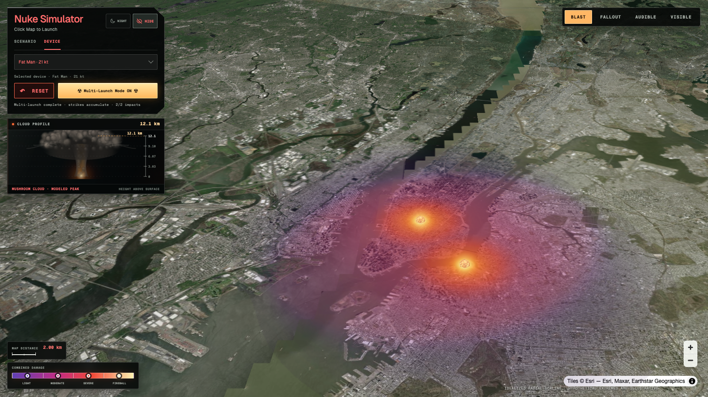
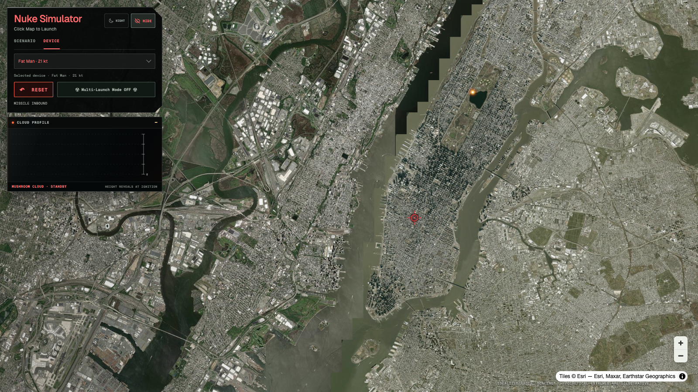
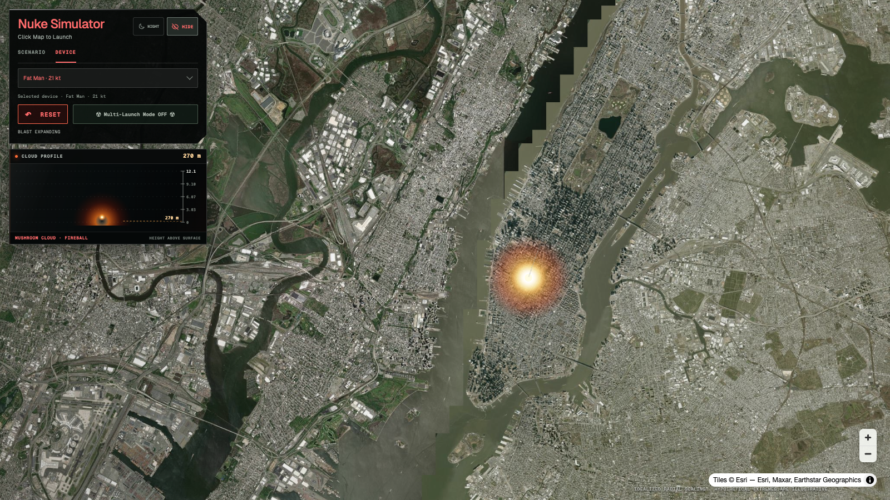
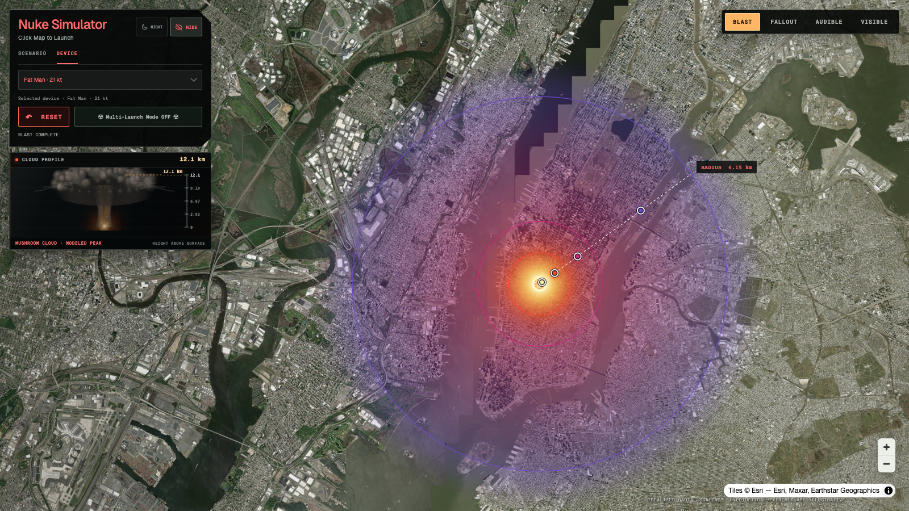
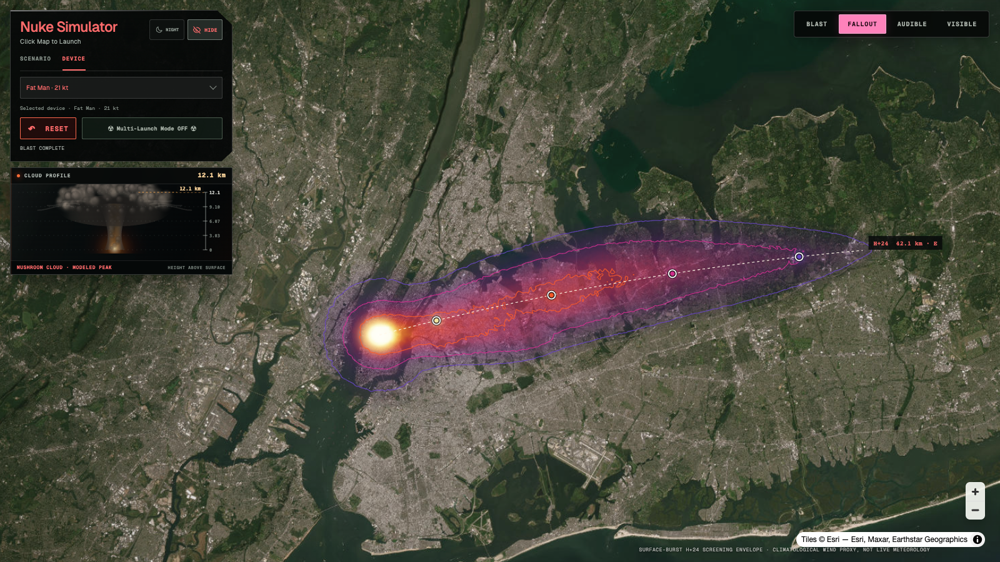
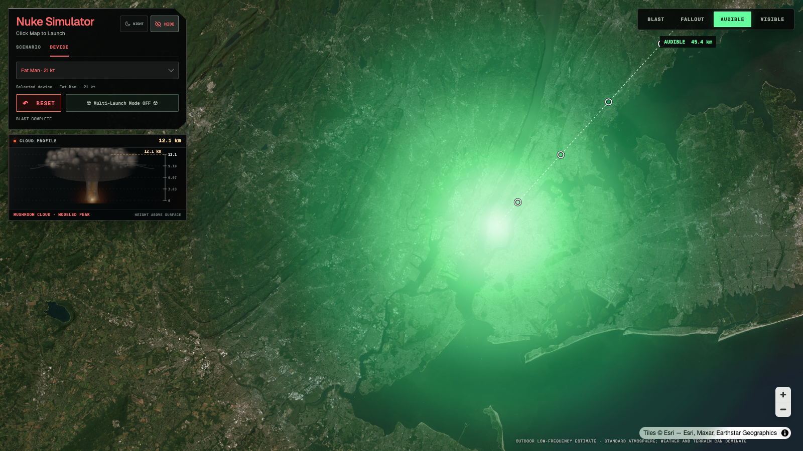
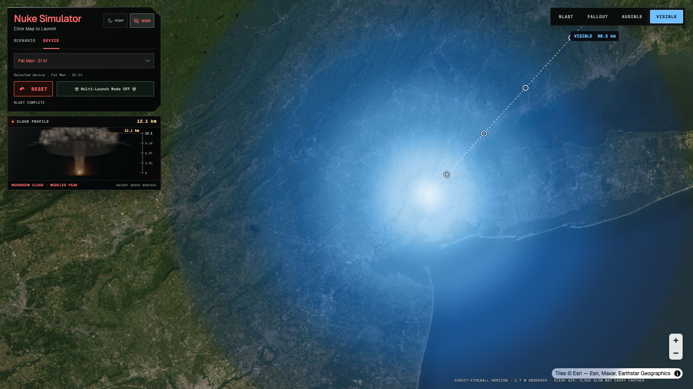

# Nuke Simulator

Nuke Simulator is a full-screen satellite-map effects visualizer based on the read-only application in `prototype-code/` and the images in `prototype-screenshots/`. The goal is to preserve its interaction, motion, and appearance while keeping the model, application state, and drawing code separate. Its effects are illustrative screening estimates, not forecasts or emergency guidance.

**Open the Site:** [Nuke Simulator](https://nuke.maquaman.chatgpt.site). Visitors do not need to install or run this repository.

## See it in action

Each image is captured from the simulator with Esri World Imagery and its attribution visible. The colored fields are illustrative estimates; see [model assumptions](site/docs/model.md) for their limits. Open an image to see its full resolution.

*Multi-launch: a pitched view shows two fireballs within overlapping fields.*

| Incoming missile | Impact flash |
| --- | --- |
|  |  |

| Settled Blast | Fallout screening envelope |
| --- | --- |
|  |  |

| Audible range | Visible range |
| --- | --- |
|  |  |

## Use the simulator

Choose one of 52 fixed devices, enter a custom yield, or select one of 20 scenarios. Conventional weapons run from weakest to strongest by TNT-equivalent yield, including five smaller weapons below the MOAB. Their TNT-equivalent values are approximate pressure-based comparisons for specified explosive fills, not measured forecasts. A scenario prepares the device and moves the camera; click the map to launch. The default device is Fat Man at 21 kt. Pan and zoom normally, and right-drag upward to pitch the map. The imagery keeps its Esri attribution visible.

On a desktop with a fine pointer and hover, open the Device or Scenario dropdown and scroll through its options or navigate with the keyboard to see a preview. Opening alone shows no preview. Weapon panels show a researched exterior outline and facts about the identified weapon, projectile, warhead, or carrier, ending at the facts. Inapplicable payload/fill rows are omitted. Scenario panels pair a full, uncropped red monochrome AI illustration with a short, dark event description. Browsing changes neither selection nor camera; click an option or press Enter to select it. The panel and its scrolling viewport disappear immediately when the dropdown loses focus or closes, including Tab, Escape, or a window switch. To read longer content, use the wheel, drag the preview scrollbar, or press **Shift+PageUp / Shift+PageDown** while focus remains on the dropdown. At widths of 600 CSS pixels or less, and on devices without a fine pointer and hover, selection remains native and previews are disabled. [Research notes](site/docs/catalog-research.md) explain estimates and unknown facts; [artwork notes](site/docs/preview-artwork.md) distinguish the illustrations from archival photographs or modeled forecasts.

A click places a red target and sends an amber-white missile along a curved, smoky path for about 6.5 seconds. Keyboard users can tab to **Launch at map center** and press Enter or Space to launch at the current map center. Impact produces a flash, expanding color field, and textured ground-anchored fireball. On wider screens, the separate cloud instrument rises with the blast and shows a modeled peak height. The default single-launch mode replaces the previous click. When the blast settles, a dashed ruler, four zone outlines, and keyboard-accessible markers explain the modeled spans; hover or focus a marker, click to pin its popup, and press Escape to clear it. Launch phases are announced even when the panels are hidden.

When the device requests reduced motion, flight and expansion take about 2.1 seconds in total. Smoke, impact flash, shock ring and cloud ignition flash are suppressed, the target stops pulsing, and the fireball texture remains still. The same modeled effect and settled map remain available.

Multi-Launch Mode keeps every click and permits a new inbound missile while earlier effects expand. Missiles enter from one general direction. Overlapping Blast fields advance toward warmer colors; overlapping range fields brighten within their green or blue palettes. No overlap changes a device's yield or geographic radius. Its lower-left map scale and legend replace the single-strike ruler. Turning multi mode off keeps the latest whole click group. A MIRV choice launches one carrier that separates into three or ten reentry vehicles, each with its own target, per-warhead effect size, and impact; the group stays intact when modes change. The carrier normally splits near 60% of flight and can separate earlier when its targets would otherwise lie behind it. Reset clears all effects and returns the cloud instrument to standby while preserving the selected device, launch mode, and camera.

After all retained launches settle, switch among Blast, eligible Fallout, Audible, and Visible. Fallout is available when at least one retained impact is nuclear; conventional-only scenes omit it, and a mixed scene shows only its nuclear fields. Each MIRV warhead contributes its own footprint. A new launch returns to Blast at the clicked camera, keeping its target visible. In single mode, Fallout frames the downwind envelope and selecting the Blast tab restores the earlier camera; multi mode preserves the camera when switching. Its bright local core, irregular purple-to-yellow plume, curved H+24 ruler, and four inspectable bands reproduce the prototype's screening illustration. The wind is a deterministic location-based proxy, and the printed Gy ranges are prototype labels, not calculated radiation doses or a live forecast.

Audible shows a soft green outdoor hearing range, separate from Blast damage. Visible shows a white-to-navy field for a direct line of sight to the luminous fireball from a 1.7 m observer in clear air. In either range view, a single delivery has a dashed geographic ruler, a kilometer radius label, and four focusable markers; multi mode replaces these with a map-distance scale and four-band legend. Audible describes Faint, Loud, Painful, and Deafening hearing experiences; Visible describes Faint, Clear, Brilliant, and Blinding viewing experiences. Popups give the modeled span, while overlapping ranges intensify the display without adding yields. Weather and terrain affect actual audibility; clouds, buildings, terrain, and atmospheric clarity affect what can be seen.

Use **Night** in the control header to darken the satellite imagery; press it again to restore the day view. The effects, map camera, and provider attribution stay in place. **Hide** slides the controls and cloud monitor away so more map is available for targeting. **Show Controls** restores the available panels. The effect tabs remain available while the panels are hidden, and a map click still launches with the selected device and mode. Both controls are keyboard operable; hiding moves focus to Show Controls, and restoring returns it to Hide. Night and panel visibility persist through Reset. At widths of 600 CSS pixels or less, the cloud monitor is hidden and the controls compact to leave a launchable map area, with effect tabs and legends placed above the attribution and beside map navigation. The monitor returns on wider screens.

If a high-zoom or narrow MIRV click cannot produce a visible forward flight, its target appears immediately while the camera briefly reframes before launch. Clicks made during that ease retain their selected device and are handled in order in multi mode; Reset cancels pending launches. If framing still fails after bounded attempts, the map remains usable and asks you to zoom out and try again.

## How it is built

The static Site uses React, TypeScript, Vite, MapLibre GL JS, Canvas 2D, and a MapLibre-aligned WebGL fireball layer. The typed catalog holds device and scenario data. Pure domain functions calculate geodesic targets, per-impact blast, audible, and direct-fireball viewing radii, cloud height, deterministic wind and fallout footprints, and bounded display intensity. Physical distances use kilometers and yields use megatons; normalized field intensity is neither sound pressure, radiation dose, nor measured brightness. The application store treats each map click as a launch group, advances it with an injected clock, and exposes immutable frames. Rendering projects those frames through the current map camera; React displays state and dispatches user actions. Fallout samples each footprint into a reusable geographic texture, shows all retained plumes together at coarse detail, then refines them. Moving the camera reprojects the cached textures and contours instead of repeating the model calculation. Audible and Visible use the same bounded geographic range renderer with separate physical radius functions and palettes. It reprojects a completed field during camera movement; a bounded rebuild replaces that cache after the camera settles. See [architecture](architecture.md), the [Site source guide](site/README.md), and [model assumptions](site/docs/model.md).

Preview data and its UI load on demand, and only the active candidate requests artwork. A bounded image cache and cancellation keep stale loads from reviving a dismissed panel. These informational previews do not change the physical model, launch sequence, or map renderer.

The map uses Esri World Imagery with visible provider attribution. Night adjusts the raster's saturation, contrast, and brightness, with a translucent vignette above the imagery; it does not recalculate geographic effects. Hiding the panels removes their camera padding and repaints markers and fields from the current camera so they remain aligned. Live tiles can change or fail; browser tests use a fixed local tile so they do not depend on the map service. When the page becomes visible or focused again, the fireball overlay requests a fresh map projection before painting. [Visual reference notes](site/docs/visual-reference.md) explain the reviewed comparison states, test limits, and remaining differences.

## Development and review

Node.js 22.13 or newer is required. From the repository root, run `npm ci --prefix site`, `npx --prefix site playwright install chromium`, then `npm run verify`. This checks types, lint, unit and integration tests, the production build, and browser paths. Local preview is for engineering; the published Site is the user-facing application.

[GitHub](https://github.com/hanegraaff/nuclear-sim) is the source of truth. The `site/` directory belongs to this repository. [Sites publishing](docs/sites-publishing.md) describes the exact-source temporary checkout and clean verification. The [roadmap](roadmap.md) records each increment, status, and Site version. [Requirements](requirements.md) and [project instructions](AGENTS.md) define behavior, tests, and read-only prototype handling.

To run the full next-plan workflow, invoke [`$implement-next-plan`](.agents/skills/implement-next-plan/SKILL.md). Its developer, browser tester, and technical writer prepare the PR for your review; an independent code reviewer is used for higher-risk changes.
